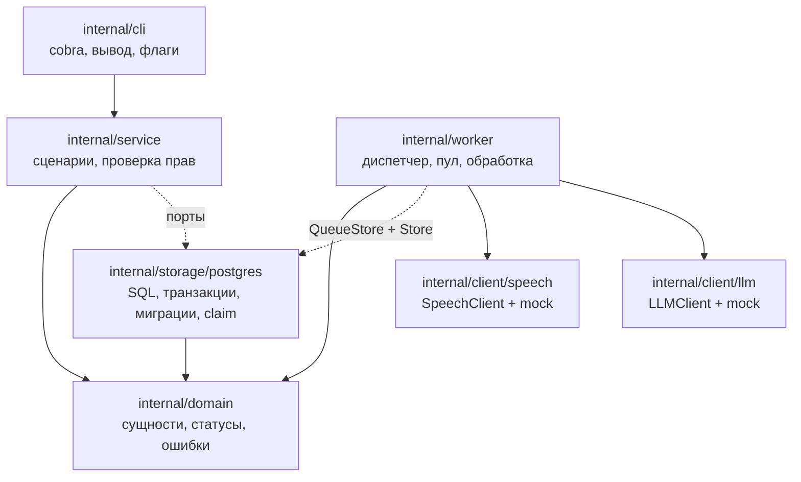
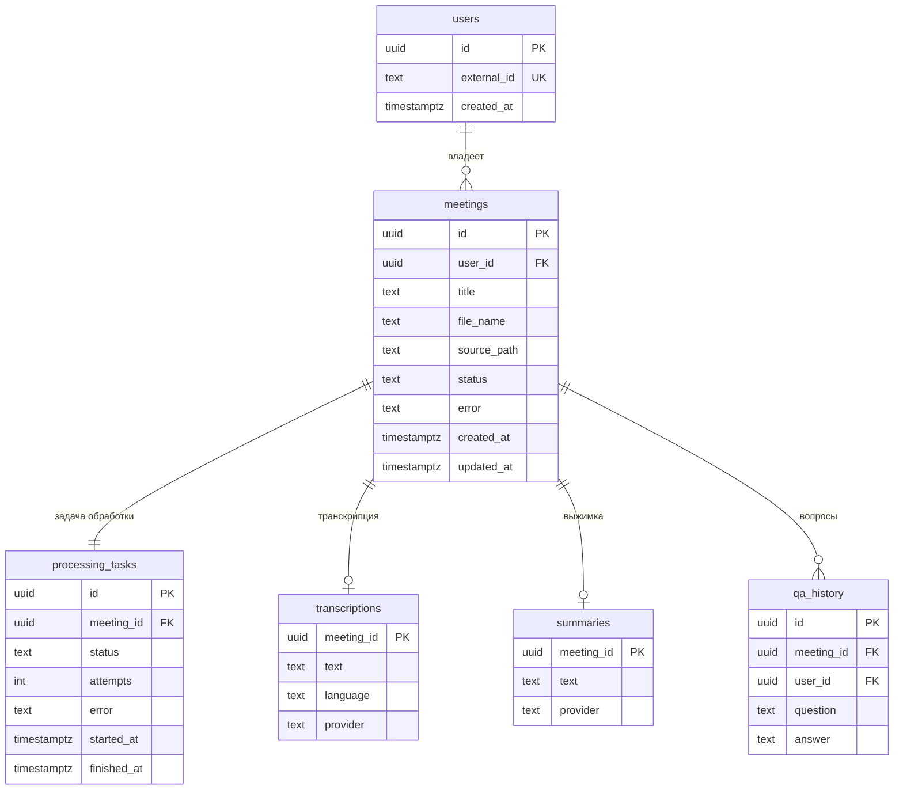
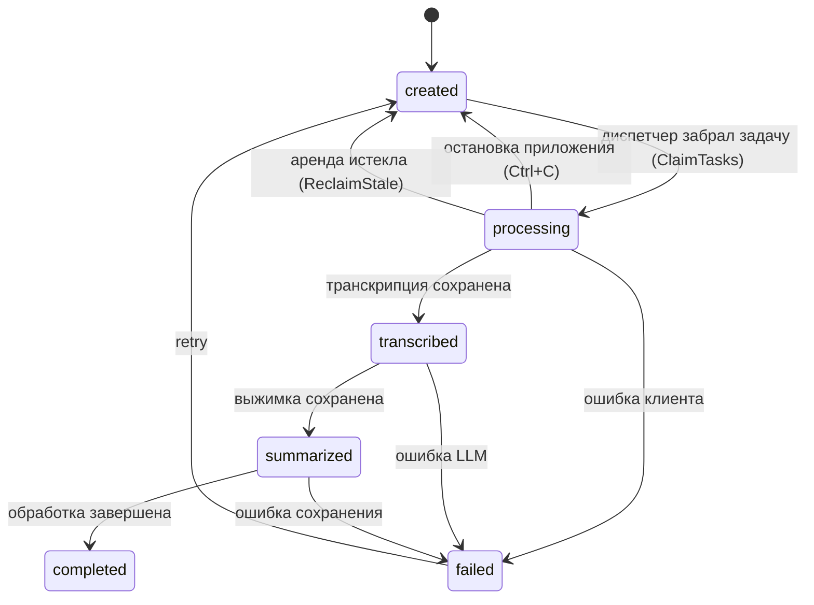
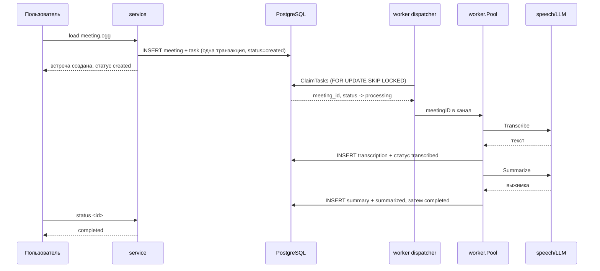

# Архитектура

Документ отвечает на вопросы, которые задают на защите: как разделены слои, как
устроена модель данных, где живёт конкурентность, как проверяются права доступа.

## Слои и зависимости



Правило зависимостей: `cli → service → domain`, инфраструктура знает только про
`domain`. Внешние пакеты (`pgx`, `goose`, `cobra`, `yaml`) живут в трёх местах —
`internal/cli`, `internal/storage/postgres` и `internal/config`. Поэтому
`internal/domain`, `internal/service` и `internal/worker` читаются без знания
библиотек.

Интерфейсы объявлены на стороне потребителя:

| Интерфейс | Где объявлен | Кто реализует |
|---|---|---|
| `Service` | `internal/cli` | `*service.Service` |
| `Worker` | `internal/cli` | `*worker.Pool` |
| `Repository` | `internal/service` | `*postgres.Store` |
| `TaskQueue` | `internal/service` | `*worker.Pool` |
| `QueueStore` | `internal/worker` | `*postgres.Store` |
| `Store` | `internal/worker` | `*postgres.Store` |
| `SpeechClient` | `internal/client/speech` | `speech.Mock` |
| `LLMClient` | `internal/client/llm` | `llm.Mock` |

Два интерфейса пула отражают два пути постановки задачи: `TaskQueue` — быстрый
путь внутри процесса (`load --wait` кладёт задачу в канал напрямую), `QueueStore` —
путь через базу (`ClaimTasks`, `ReclaimStale`, `RecoverPending`).

## Модель данных



Индексы:

| Индекс | Зачем |
|---|---|
| `meetings(user_id, created_at desc)` | `list` |
| `meetings(user_id, status)` | `stats`, выборки по статусу |
| `processing_tasks(status)` | восстановление незавершённых задач |
| `processing_tasks(status, created_at)` | выборка очереди диспетчером |
| `processing_tasks(meeting_id)` UNIQUE | `status <id>`, `retry <id>`; одна встреча — одна задача |
| `qa_history(meeting_id, created_at)` | история вопросов |
| GIN `to_tsvector('russian', text)` на `transcriptions` и `summaries` | полнотекстовый `find` |

## Жизненный цикл обработки



Граф описан в `internal/domain/status.go` и покрыт юнит-тестами. Проверку
переходов при записи выполняет инфраструктурный слой, а не модель: `ClaimTasks`
переводит только `created → processing`, `ReclaimStale` и `RequeueInterrupted` —
только `processing → created`, остальные переходы делает `markStatus` в транзакции
сохранения результата. Статус встречи и статус задачи меняются в одной транзакции:
пользователь смотрит на встречу, обработчик — на задачу, и расхождение выглядит
как зависание.

## Асинхронная обработка



**Очередь — таблица `processing_tasks`, а не канал.** Канал остался между
диспетчером и воркерами: он даёт минимальную задержку доставки, но живёт внутри
процесса и не видит задачи других процессов. База — durable inbox, общий для всех.

Захват задачи одной транзакцией:

```sql
UPDATE processing_tasks t
SET status = 'processing', attempts = attempts + 1, started_at = now()
FROM (SELECT id FROM processing_tasks
      WHERE status = 'created'
      ORDER BY created_at
      FOR UPDATE SKIP LOCKED
      LIMIT $1) picked
WHERE t.id = picked.id
RETURNING t.meeting_id
```

`SKIP LOCKED` не даёт двум процессам взять одну задачу: занятую строку второй
пропускает и берёт следующую. `attempts` растёт в момент захвата — если процесс
умрёт сразу после, попытка всё равно учтена.

Диспетчер — одна горутина в `worker.Pool`:

- `select` по трём источникам: `ctx.Done()`, тикер, `kick` (новая задача в этом
  же процессе — не ждём тик);
- пачка ограничена свободными слотами (`concurrency − active − len(queue)`),
  поэтому лишнее остаётся в `created`, а не висит в памяти;
- интервал адаптивный: `WORKER_POLL_INTERVAL` при работе, до 2 с в простое.

Лимит параллелизма задаётся числом воркеров, а не семафором: количество горутин
постоянно (`concurrency + 1`). `TASK_TIMEOUT` ограничивает весь цикл,
`SPEECH_TIMEOUT`/`LLM_TIMEOUT` — каждый вызов.

### Остановка и восстановление

| Событие | Что происходит | Кто продолжит |
|---|---|---|
| Ctrl+C / SIGTERM | `RequeueInterrupted`: задача → `created` | следующий запуск |
| процесс убит `kill -9` | задача остаётся в `processing` | `ReclaimStale` по аренде (`task_timeout + 1m`) |
| таймаут задачи, ошибка клиента | `MarkFailed`: задача → `failed` | только `retry <id>` |
| старт `serve` | `RecoverPending`: прерванные прошлым запуском → `created` | этот же процесс |

Запись итога идёт в `context.WithoutCancel` с коротким таймаутом: контекст задачи
может быть уже мёртв, а статус записать нужно.

Глобальный сброс «все `processing` → `created`» не используется: он сбрасывал бы
и задачи живого обработчика в соседнем процессе.

## Права доступа

Проверка идёт на двух уровнях, и оба обязательны:

1. **SQL.** Все пользовательские выборки фильтруются по `user_id` в `WHERE`:
   `GetMeeting`, `ListMeetings`, `DeleteMeeting`, `GetTranscription`, `GetSummary`,
   `SearchMeetings`, `ListQuestions`. Метода без `user_id` для пользовательских
   сценариев не существует.
2. **Сервис.** Материалы (`Transcription`, `Summary`, `Ask`) читаются только после
   `GetMeeting(ctx, id, userID)`. Иначе на чужой идентификатор вернулось бы
   «транскрипция ещё не готова» — это подсказка о существовании встречи.

Чужой идентификатор неотличим от несуществующего: `ErrNotFound` в обоих случаях.
Отдельно существует `GetMeetingByID` без фильтра — только для фонового обработчика,
который действует от имени системы.

## Обработка ошибок

### Ошибки внешних клиентов

`internal/client` объявляет виды сбоев: `ErrUnavailable`, `ErrTimeout`,
`ErrRejected`, `ErrInvalidRequest`. Клиент оборачивает причину в `*client.Error`,
у которого `Unwrap() []error`, поэтому одновременно работают
`errors.Is(err, client.ErrTimeout)` и `errors.Is(err, context.DeadlineExceeded)`.

Решение о повторе принимает `client.IsTemporary`. В базу попадает человеческий
текст («внешний сервис не ответил вовремя»), а подробности остаются в логах.

### Прочие ошибки

- `domain.ErrNotFound / ErrValidation / ErrInvalidTransition` — проверяются через
  `errors.Is` в сервисе и CLI, текст ошибки не разбирается.
- Ошибки БД оборачиваются с указанием операции (`fmt.Errorf("...: %w", err)`),
  наружу отдаётся текст без строки подключения.
- `ErrNotReady` отделяет «ещё обрабатывается» от «не найдено».
- CLI возвращает ошибку в `main`, печатает её один раз в stderr, ставит код 1.

## Конфигурация

Три источника, применяются по порядку: умолчания → YAML (`CONFIG_FILE`) →
переменные окружения. Проверка диапазонов и форматов выполняется для любого
источника, все найденные проблемы возвращаются одной ошибкой. Пароль из `DB_DSN`
редактируется перед попаданием в текст ошибки.

## Тестовые реализации и заменяемость

`main.go` выбирает реализации по `SPEECH_PROVIDER` и `LLM_PROVIDER`. Рантайм
поддерживает `mock`; для `yandex` и `gigachat` приложение завершается понятной
ошибкой при старте, а не падает в глубине обработки. Добавление реального клиента
не меняет ни `service`, ни `worker`: нужно объявить структуру с методами
интерфейса (`Transcribe`/`Provider` или `Summarize`/`Answer`/`Provider`) и
добавить ветку в `newSpeechClient`/`newLLMClient`.
