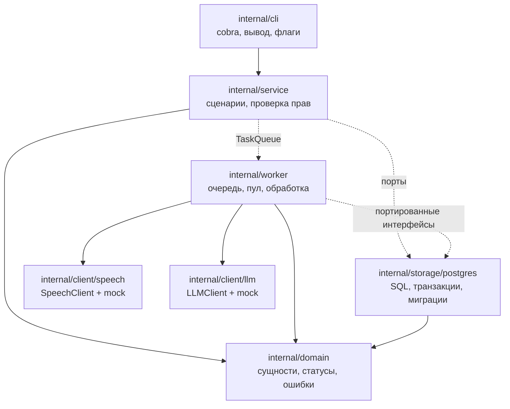
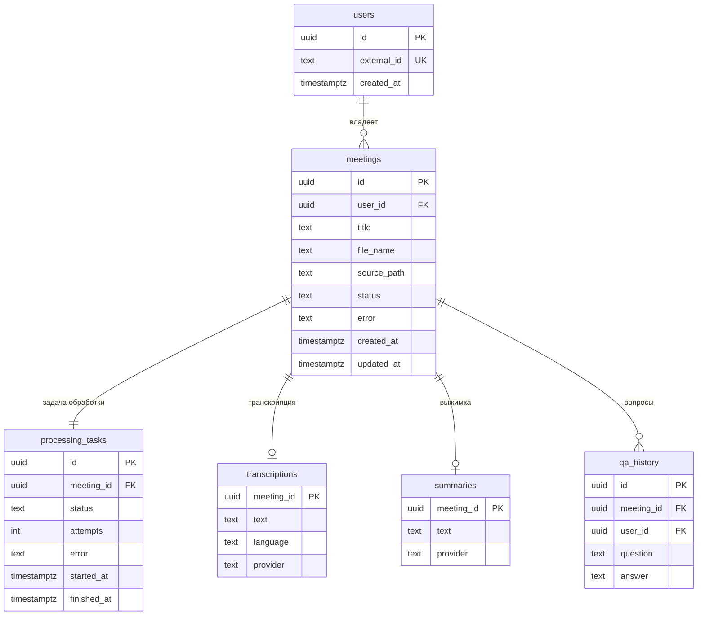
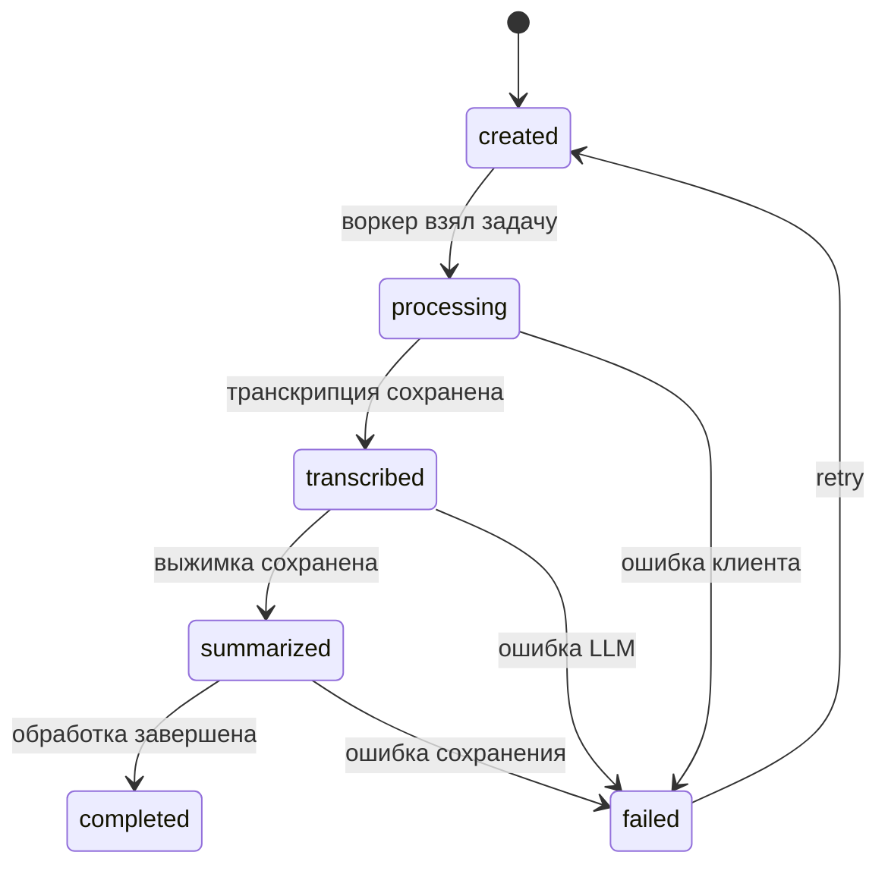
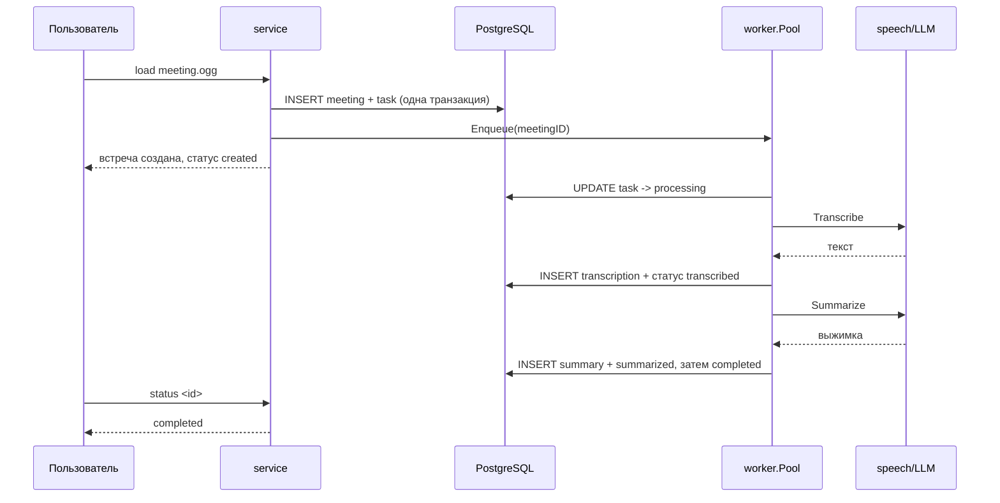

# Архитектура

Документ отвечает на вопросы, которые задают на защите: как разделены слои, как
устроена модель данных, где живёт конкурентность, как проверяются права доступа.

## Слои и зависимости

Правило зависимостей: `cli → service → domain`, инфраструктура знает только про
`domain`. Внешние пакеты (`pgx`, `goose`, `cobra`, `yaml`) живут в трёх местах —
`internal/cli`, `internal/storage/postgres` и `internal/config`. Поэтому
`internal/domain`, `internal/service` и `internal/worker` читаются без знания
библиотек.

Интерфейсы объявлены на стороне потребителя:

| Интерфейс | Где объявлен | Кто реализует |
|---|---|---|
| `Service` | `internal/cli` | `*service.Service` |
| `Worker` | `internal/cli` | `*worker.Pool` |
| `Repository` | `internal/service` | `*postgres.Store` |
| `TaskQueue` | `internal/service` | `*worker.Pool` |
| `Store` | `internal/worker` | `*postgres.Store` |
| `SpeechClient` | `internal/client/speech` | `speech.Mock` |
| `LLMClient` | `internal/client/llm` | `llm.Mock` |

## Модель данных

Индексы:

| Индекс | Зачем |
|---|---|
| `meetings(user_id, created_at desc)` | `list` |
| `meetings(user_id, status)` | `stats`, выборки по статусу |
| `processing_tasks(status)` | восстановление незавершённых задач |
| `processing_tasks(meeting_id)` | `status <id>`, `retry <id>` |
| `qa_history(meeting_id, created_at)` | история вопросов |
| GIN `to_tsvector('russian', text)` на `transcriptions` и `summaries` | полнотекстовый `find` |

## Жизненный цикл обработки

Переходы описаны в `internal/domain/status.go` и проверяются методом
`Status.Transition`. Статус встречи и статус задачи меняются в одной транзакции:
пользователь смотрит на встречу, обработчик — на задачу, и расхождение выглядит
как зависание.

## Асинхронная обработка

- Очередь — буферизованный канал, пул — `WORKER_CONCURRENCY` горутин.
- Лимит параллелизма задаётся числом воркеров, а не семафором: количество горутин
  постоянно, лишние задачи ждут в буфере. Переполнение даёт `ErrQueueFull`,
  задача при этом уже сохранена в базе.
- `TASK_TIMEOUT` ограничивает весь цикл, `SPEECH_TIMEOUT`/`LLM_TIMEOUT` — каждый
  вызов. Ошибка записывается в контексте `context.WithoutCancel`: если задачу убил
  таймаут, её контекст уже мёртв, а статус `failed` записать нужно.
- `serve` при старте вызывает `RecoverPending`: задачи, застрявшие в
  `processing/transcribed/summarized`, возвращаются в `created`.

## Права доступа

Проверка идёт на двух уровнях, и оба обязательны:

1. **SQL.** Все пользовательские выборки фильтруются по `user_id` в `WHERE`:
   `GetMeeting`, `ListMeetings`, `DeleteMeeting`, `GetTranscription`, `GetSummary`,
   `SearchMeetings`, `ListQuestions`. Метода без `user_id` для пользовательских
   сценариев не существует.
2. **Сервис.** Материалы (`Transcription`, `Summary`, `Ask`) читаются только после
   `GetMeeting(ctx, id, userID)`. Иначе на чужой идентификатор вернулось бы
   «транскрипция ещё не готова» — это подсказка о существовании встречи.

Чужой идентификатор неотличим от несуществующего: `ErrNotFound` в обоих случаях.
Отдельно существует `GetMeetingByID` без фильтра — только для фонового обработчика,
который действует от имени системы.

## Обработка ошибок

### Ошибки внешних клиентов

`internal/client` объявляет виды сбоев: `ErrUnavailable`, `ErrTimeout`,
`ErrRejected`, `ErrInvalidRequest`. Клиент оборачивает причину в `*client.Error`,
у которого `Unwrap() []error`, поэтому одновременно работают
`errors.Is(err, client.ErrTimeout)` и `errors.Is(err, context.DeadlineExceeded)`.

Решение о повторе принимает `client.IsTemporary`. В базу попадает человеческий
текст («внешний сервис не ответил вовремя»), а подробности остаются в логах.

### Прочие ошибки

- `domain.ErrNotFound / ErrValidation / ErrInvalidTransition` — проверяются через
  `errors.Is` в сервисе и CLI, текст ошибки не разбирается.
- Ошибки БД оборачиваются с слоем (`fmt.Errorf("...: %w", err)`), `pgconn.PgError`
  разбирается через `errors.As` там, где важен код.
- `ErrNotReady` отделяет «ещё обрабатывается» от «не найдено».
- CLI возвращает ошибку в `main`, печатает её один раз в stderr, ставит код 1.

## Конфигурация

Три источника, применяются по порядку: умолчания → YAML (`CONFIG_FILE`) →
переменные окружения. Проверка диапазонов и форматов выполняется для любого
источника, все найденные проблемы возвращаются одной ошибкой. Пароль из `DB_DSN`
редактируется перед попаданием в текст ошибки.
